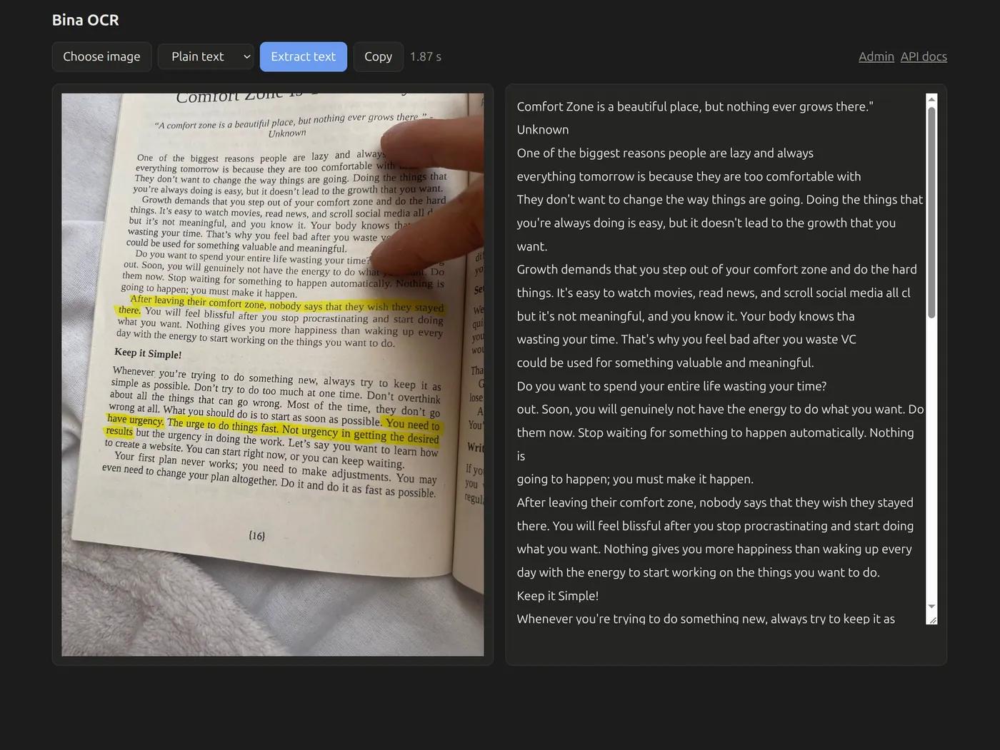
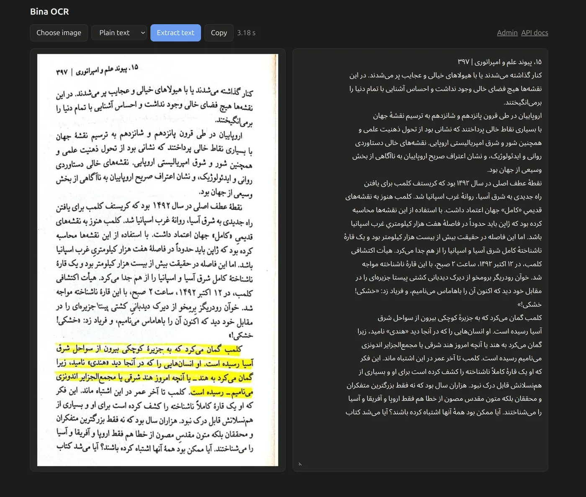
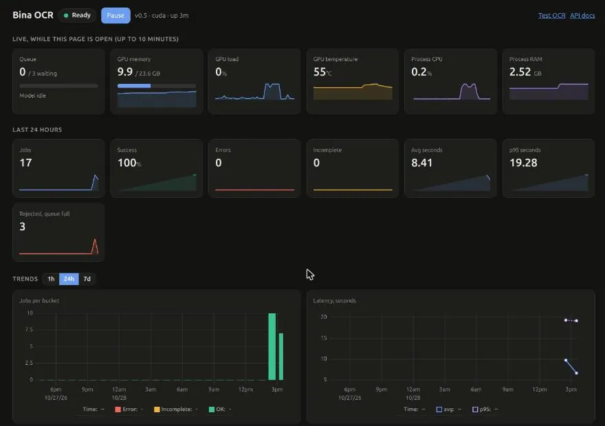

# Bina OCR server

Local HTTP server + web UI for [Reza2kn/Bina-0.4-Koochik](https://huggingface.co/Reza2kn/Bina-0.4-Koochik) (Persian/English OCR), full model on GPU (BF16) or CPU.

```
model/          model code + configs from HF (weights downloaded)
server/ocr.py   model loading + transcription (splits regions that loop)
server/app.py   HTTP server
server/jobs.py  queue admission, pause, SQLite job history
server/monitor.py  GPU/CPU/RAM samples for the admin page
server/static/  web UI (vendor/: uPlot charts)
samples/        test images and outputs
assets/         README screenshots
data/           job history + thumbnails (created at runtime, not in git)
.venv/          Python 3.11 env (not in git)
```

## Screenshots

English:



Persian:



Admin panel (`/admin`):



## Model

Only the weights (`model/model.safetensors`, 2.4 GB, BF16) are not in git. They come from [Reza2kn/Bina-0.4-Koochik](https://huggingface.co/Reza2kn/Bina-0.4-Koochik), based on [nvidia/Nemotron-3.5-Parse](https://huggingface.co/nvidia/Nemotron-3.5-Parse).

## Setup (once)

```sh
git clone https://github.com/AliReza99/bina-persian-ocr && cd bina-persian-ocr
uv venv -p 3.11 .venv
uv pip install -p .venv huggingface_hub -r model/requirements.txt
.venv/bin/hf download Reza2kn/Bina-0.4-Koochik model.safetensors --local-dir model
```

## Run

```sh
./run.sh                                       # 127.0.0.1:8001, auth off
OCR_TOKEN=secret ./run.sh --host 100.x.y.z     # Tailscale IP; token required off localhost
```

UI: http://127.0.0.1:8001/ , admin: /admin

Tested on Linux. On other systems the process RAM card shows `-`.

### Admin panel

- **Live** (only while the page is open, one sample per 5 s, last 10 minutes): queue, GPU memory/load/temperature, process CPU and RAM. Nothing is sampled when no one is watching.
- **Last 24 hours**: jobs, success %, errors, incomplete, avg and p95 seconds, requests rejected because the queue was full.
- **Trends** (1h / 24h / 7d): jobs per bucket, latency, seconds vs image size, top clients, task split.
- **Jobs**: filter by status, client, task or id; sort; 50 per page. Times are relative (click to show full dates). Click a job for its image, details and extracted text.
- **Pause / Resume**: pause rejects new `/ocr` requests with `503 paused`; the running and queued jobs still finish. Use it before maintenance. Not kept across restarts.
- **Clear history** (footer, click twice): deletes all jobs, thumbnails and stored text.

Run as a service on boot: see `deploy/bina-ocr.service`. Job history, thumbnails and extracted text live in `data/` (30 days / 5000 jobs). Anyone with admin access can read the stored text.

## API

### `POST /ocr`

Extract the text (Persian/English) from one image. One image runs at a time; up to 3 more wait, beyond that the server answers `503 busy`.

**Auth**: when the server has `OCR_TOKEN` set, send `Authorization: Bearer <token>` (all routes except `/health`, `/login`). Optional `X-Client: <name>` labels the job in the admin history.

Images with a long edge over 2500 px are downscaled first; over 100 MP are rejected.

**Query**

| Param | Values | Default | Meaning |
|---|---|---|---|
| `task` | `ocr`, `markup` | `ocr` | `ocr` = plain text, `markup` = Markdown/math |

**Body**: raw image bytes (PNG, JPG, WebP, anything Pillow reads), max 30 MB. No multipart, no JSON. `Content-Type` is ignored.

**Response 200** `application/json`

```json
{
  "text": "این یک متن آزمایشی است.\n123 + 456 = 579",
  "incomplete": false,
  "seconds": 0.36
}
```

| Field | Type | Meaning |
|---|---|---|
| `text` | string | transcript, lines separated by `\n` |
| `incomplete` | bool | `true` if some region still hit a repetition loop after splitting; part of the text may be missing |
| `seconds` | number | inference time |

**Errors** (all `{"error": "<message>"}`)

| Status | When |
|---|---|
| 400 | empty body, unreadable image, or bad `task` |
| 404 | unknown path |
| 401 | missing or wrong token |
| 413 | body over 30 MB, or image over 100 MP |
| 500 | inference failed |
| 503 | `{"error": "busy"}` queue full, or `{"error": "paused"}` paused by admin; see `Retry-After` |

**Examples**

```sh
curl --data-binary @page.jpg http://127.0.0.1:8001/ocr
curl --data-binary @page.jpg 'http://127.0.0.1:8001/ocr?task=markup'
```

```python
import requests
r = requests.post('http://127.0.0.1:8001/ocr', data=open('page.jpg', 'rb'))
print(r.json()['text'])
```

```js
const r = await fetch('http://127.0.0.1:8001/ocr', { method: 'POST', body: file }); // file: Blob/File/Buffer
const { text } = await r.json();
```

### `GET /health`

`200 {"status": "ok", "device": "cuda", "version": "0.5", "busy": false, "waiting": 0, "docs": "/docs"}`. `status` is `ok` or `paused`, `device` is `cuda` or `cpu`. No auth.

### Admin

Same auth as `/ocr`. Used by the `/admin` page.

| Route | Returns |
|---|---|
| `GET /admin/state` | `paused`, `running` (`{id, client, started}` or null), `waiting`, `max_waiting`, `stats` (last 24h: `jobs_24h`, `errors_24h`, `incomplete_24h`, `busy_24h`, `success_pct`, `avg_seconds`, `p95_seconds`), `version`, `device`, `uptime` (s), `samples` (live metrics, see below) |
| `GET /admin/series?range=1h\|24h\|7d` | per bucket `t`, `ok`, `incomplete`, `error`, `rejected`, `avg`, `p95`; plus `scatter` (`[megapixels, seconds]`), `clients` and `tasks` (`[name, count]`) |
| `GET /admin/jobs` | `{"jobs": [...], "total": n}`. Query: `sort` (`recent`, `slowest`, `failed`), `status` (`ok`, `incomplete`, `error`, `running`), `client`, `task`, `id`, `offset`, `limit` (default 50, max 200) |
| `GET /admin/text/<id>` | `{"text": "..."}`, null for failed jobs and jobs recorded before text was stored |
| `GET /admin/thumb/<id>` | JPEG thumbnail |
| `POST /admin/pause`, `POST /admin/resume` | stop / start accepting `/ocr` |
| `POST /admin/clear` | deletes all job history |

`samples` items: `{t, cpu, rss_mb, gpu_load, gpu_temp, gpu_used_mb, gpu_total_mb}`, any of them null when unavailable. Reading `/admin/state` takes a sample at most every 5 s; after 30 s without reads the history starts over.

Bad query values return `400`.

### `GET /docs`, `GET /llms.txt`

This API section, as `text/markdown`. Unknown paths return `404 {"error": "not found", "docs": "/docs"}`.

### `GET /`

Web UI.

Web UI (login with the token when `OCR_TOKEN` is set).
