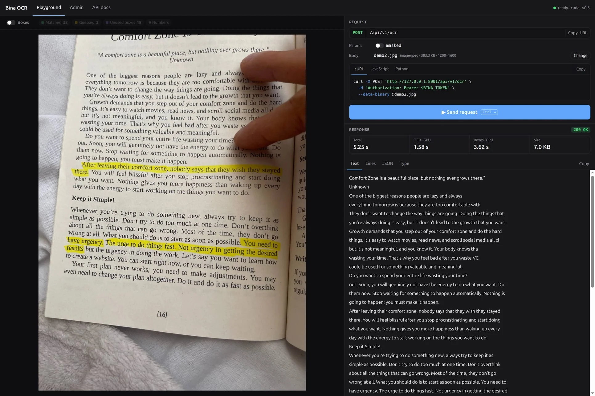
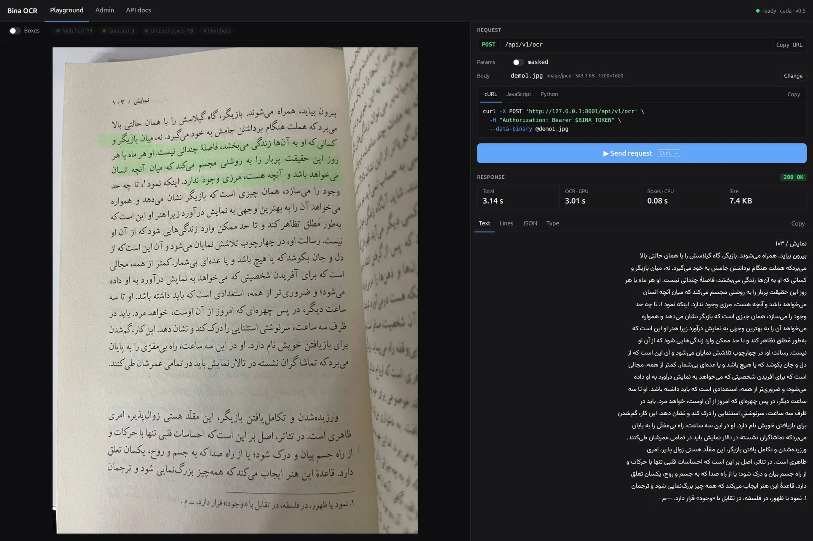
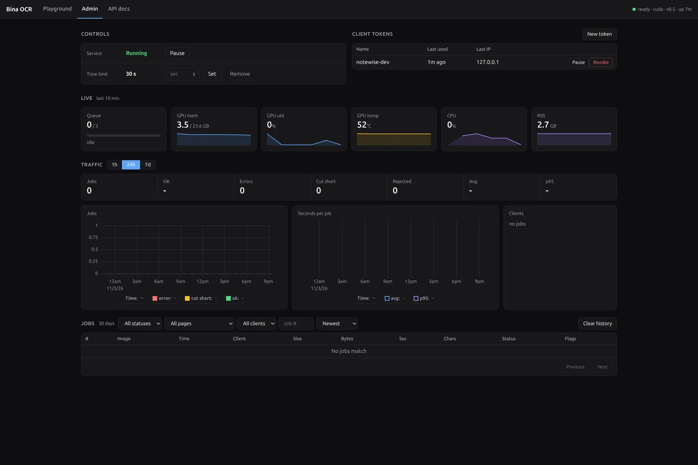

# Bina OCR server

Local HTTP server + web UI for [Reza2kn/Bina-0.4-Koochik](https://huggingface.co/Reza2kn/Bina-0.4-Koochik) (Persian/English OCR), full model on GPU (BF16) or CPU.

```
model/          model code + configs from HF (weights downloaded)
server/ocr.py   model loading + transcription (splits regions that loop)
server/align.py line boxes: where each OCR line sits on the page
server/app.py   HTTP server
server/jobs.py  queue admission, pause, SQLite job history
server/monitor.py  GPU/CPU/RAM samples for the admin page
server/static/  web UI (vendor/: uPlot charts)
server/test_*.py  self-checks, run each with .venv/bin/python
samples/        test images and outputs
assets/         README screenshots
data/           job history + thumbnails (created at runtime, not in git)
.venv/          Python 3.11 env (not in git)
```

## Screenshots

English:



Persian:



Admin panel (`/admin`):



## Model

Only the weights (`model/model.safetensors`, 2.4 GB, BF16) are not in git. They come from [Reza2kn/Bina-0.4-Koochik](https://huggingface.co/Reza2kn/Bina-0.4-Koochik), based on [nvidia/Nemotron-3.5-Parse](https://huggingface.co/nvidia/Nemotron-3.5-Parse).

## Setup (once)

```sh
git clone https://github.com/AliReza99/bina-persian-ocr && cd bina-persian-ocr
uv venv -p 3.11 .venv
uv pip install -p .venv huggingface_hub -r model/requirements.txt
.venv/bin/hf download Reza2kn/Bina-0.4-Koochik model.safetensors --local-dir model
sudo apt install tesseract-ocr tesseract-ocr-fas   # for line boxes
```

The line detector models for line boxes (PP-OCRv5, a few MB) download on the first start.

## Run

```sh
./run.sh                      # 127.0.0.1:8001
./run.sh --host 100.x.y.z     # Tailscale IP
```

UI: http://127.0.0.1:8001/ , admin: /admin, API docs with a try-it form: /api-docs. All open only from the Bina machine itself, with no login, at `127.0.0.1`, `localhost` or the `--host` address (requests from other websites get `403`); from elsewhere, tunnel in (`ssh -L 8001:127.0.0.1:8001 <bina-pc>`). Make client tokens in admin.

Tested on Linux. On other systems the process RAM card shows `-`.

### Admin panel

- **Live** (only while the page is open, one sample per 5 s, last 10 minutes): queue, GPU memory/load/temperature, process CPU and RAM. Nothing is sampled when no one is watching.
- **Last 24 hours**: jobs, success %, errors, incomplete, avg and p95 seconds, requests rejected because the queue was full.
- **Trends** (1h / 24h / 7d): jobs per bucket, latency, seconds vs image size, top clients.
- **Jobs**: filter by status, client or id; sort; 50 per page. Times are relative (click to show full dates). Click a job for its image, details and extracted text.
- **Flags**: pages whose line boxes may deserve a look (filter *Flagged*, or by reason). Click a job to see its line boxes on the image, green matched, orange guessed. Heuristics for review: some flagged pages are fine, and pages without boxes problems can still have junk in `text`.
- **Pause / Resume**: pause rejects new `/api/v1/ocr` requests with `503 paused`; the running and queued jobs still finish. Use it before maintenance. Not kept across restarts.
- **Time limit**: the longest one job may use the model (5 to 3600 s), or no limit. Past it the text read so far comes back with `incomplete: true` and the model is freed for the next job. Kept across restarts.
- **Client tokens**: make, pause or revoke. Pausing one client rejects only its requests with `503 paused`, others keep running. Kept across restarts.
- **Clear history** (footer, click twice): deletes all jobs, thumbnails and stored text.

Run as a service on boot: see `deploy/bina-ocr.service`. Job history, thumbnails and extracted text live in `data/` (30 days / 5000 jobs). Anyone with admin access can read the stored text.

## API

### `POST /api/v1/ocr`

Extract the text (Persian/English) from one image, and where each text line sits on it. One image runs at a time; up to 3 more wait, beyond that the server answers `503 busy`.

**Auth**: `/api/v1/ocr` needs `Authorization: Bearer <token>`, always, even from the Bina machine. The token is a client token, made under *Client tokens* in `/admin`; its name labels every job it sends and can't be changed by the client. Each job also records the caller's IP. `/health` is open. `/docs` takes a client token or the Bina machine. Everything else (the UI, `/admin`) is only reachable from the Bina machine.

Images with a long edge over 2500 px are downscaled first; over 100 MP are rejected.

**Query**

| Param | Values | Default | Meaning |
|---|---|---|---|
| `masked` | `0`, `1` | `0` | `1` = old masked decoding, about 1.75x slower. Default output can differ from it on hard pages (photos with a facing page, very dense text), sometimes better, sometimes with junk lines at the end |

**Body**: raw image bytes (PNG, JPG, WebP, anything Pillow reads), max 30 MB. No multipart, no JSON. `Content-Type` is ignored.

**Response 200** `application/json`

```json
{
  "text": "در باب اعتماد به نفس\nیکی از جالب‌ترین آثاری که ...",
  "incomplete": false,
  "seconds": 3.2,
  "lines": [
    { "index": 0, "text": "در باب اعتماد به نفس", "box": [[0.34, 0.05], [0.53, 0.05], [0.53, 0.07], [0.34, 0.07]], "guess": false }
  ],
  "flags": {},
  "align_seconds": 1.8
}
```

| Field | Type | Meaning |
|---|---|---|
| `text` | string | transcript, lines separated by `\n` |
| `incomplete` | bool | `true` if some region still hit a repetition loop after splitting, or the admin time limit ran out; part of the text may be missing |
| `seconds` | number | inference time |
| `lines` | array | one item per located line, in text order; lines with no box are left out |
| `lines[].index` | int | index into `text.split('\n')` (blank lines count) |
| `lines[].text` | string | that line, same as `text.split('\n')[index]` |
| `lines[].box` | 4 × `[x, y]` | corners as fractions (0..1) of the image width and height, starting top-left, clockwise; a quad, so tilted lines fit |
| `lines[].guess` | bool | `true` when the box was inferred from the lines around it rather than matched directly |
| `flags` | object | reasons the line boxes may deserve a human look, `{name: detail}`; `{}` when none. Heuristic, never changes the output. Names: `boxes_off_column`, `rows_no_box`, `box_too_wide`, `replay_in_boxes`, `bad_chars_in_box`, `merged_paragraph`, `no_lines` |
| `align_seconds` | number | time to locate the lines (CPU, about 0.3 to 3 s), after `seconds` of inference |

Locating lines never fails the request: if it breaks, `lines` is `[]` and `flags` is `{}`. The text is always the model's; the boxes only say where it is. On a typical page about 85% of lines get a box; most of the rest are fragments with nothing to point at.

**Errors** (all `{"error": "<message>"}`)

| Status | When |
|---|---|
| 400 | empty body, unreadable image, or bad `masked` |
| 404 | unknown path |
| 401 | missing or wrong token |
| 403 | admin route from another machine |
| 413 | body over 30 MB, or image over 100 MP |
| 500 | inference failed |
| 503 | `{"error": "busy"}` queue full, or `{"error": "paused"}` paused by admin, for everyone or this client; see `Retry-After` |

**Examples**

```sh
curl -H "Authorization: Bearer $BINA_TOKEN" --data-binary @page.jpg http://127.0.0.1:8001/api/v1/ocr
curl -H "Authorization: Bearer $BINA_TOKEN" --data-binary @page.jpg 'http://127.0.0.1:8001/api/v1/ocr?masked=1'
```

```python
import os, requests
r = requests.post('http://127.0.0.1:8001/api/v1/ocr', data=open('page.jpg', 'rb'),
                  headers={'Authorization': f"Bearer {os.environ['BINA_TOKEN']}"})
print(r.json()['text'])
```

```js
const r = await fetch('http://127.0.0.1:8001/api/v1/ocr', {
  method: 'POST',
  headers: { Authorization: `Bearer ${BINA_TOKEN}` },
  body: file, // Blob/File/Buffer
});
const { text } = await r.json();
```

### `GET /health`

`200 {"status": "ok", "device": "cuda", "version": "0.5", "busy": false, "waiting": 0, "docs": "/docs"}`. `status` is `ok` or `paused`, `device` is `cuda` or `cpu`. No auth.

### `GET /api/v1/whoami`

`200 {"name": "notewise-prod", "paused": false}`: the client token's name, so a client can check its token without sending a page, and whether this client is paused (it then gets `503 paused` while `/health` still says `ok`; the pause for everyone shows in `/health`). `401` if the token is missing or wrong.

### Admin

From the Bina machine only, no token. Other websites get `403` even from a browser on that machine. Used by the `/admin` page.

| Route | Returns |
|---|---|
| `GET /api/admin/state` | `paused`, `running` (`{id, client, started}` or null), `waiting`, `max_waiting`, `max_seconds` (null: no limit), `version`, `device`, `uptime` (s), `samples` (live metrics, see below) |
| `GET /api/admin/series?range=1h\|24h\|7d` | per bucket `t`, `ok`, `incomplete`, `error`, `rejected`, `avg`, `p95`; plus `totals` over the range (`jobs`, `ok`, `incomplete`, `error`, `rejected`, `avg`, `p95`), `clients` (`[name, count]`) |
| `GET /api/admin/jobs` | `{"jobs": [...], "total": n, "clients": [every client in history]}`. Each job has `flags`. Query: `sort` (`recent`, `slowest`, `failed`), `status` (`ok`, `incomplete`, `error`, `running`), `flag` (`any` or one flag name), `client`, `id`, `offset`, `limit` (default 50, max 200) |
| `GET /api/admin/text/<id>` | `{"text": "...", "lines": [...]}`; `text` null for failed jobs and jobs recorded before text was stored, `lines` `[]` without boxes |
| `GET /api/admin/thumb/<id>` | JPEG thumbnail |
| `POST /api/admin/pause`, `POST /api/admin/resume` | stop / start accepting `/api/v1/ocr` |
| `POST /api/admin/limit` | `{"max_seconds": n}` (whole seconds, 5 to 3600) or `{"max_seconds": null}` for no limit |
| `POST /api/admin/clear` | deletes all job history |
| `GET /api/admin/tokens` | `tokens`: `[{id, name, created, last_used, last_ip, paused}]` |
| `POST /api/admin/tokens` | body `{"name": "..."}`; `201 {name, token}`, the token shown only here; `409` if the name is taken |
| `POST /api/admin/tokens/<id>/pause`, `POST /api/admin/tokens/<id>/resume` | stop / start accepting this client only; `{"paused": bool}` |
| `POST /api/admin/tokens/<id>/revoke` | deletes the token |
| `POST /api/admin/ocr` | same as `POST /api/v1/ocr` (same query) plus `detector` (every detector box: `box`, `read`, `used`), no token; the Playground on `/` |

`samples` items: `{t, cpu, rss_mb, gpu_load, gpu_temp, gpu_used_mb, gpu_total_mb}`, any of them null when unavailable. Reading `/api/admin/state` takes a sample at most every 5 s; after 30 s without reads the history starts over.

Bad query values return `400`.

### `GET /docs`, `GET /llms.txt`

This API section, as `text/markdown`. Unknown paths return `404 {"error": "not found", "docs": "/docs"}`.

### `GET /`

Web UI, from the Bina machine only.
